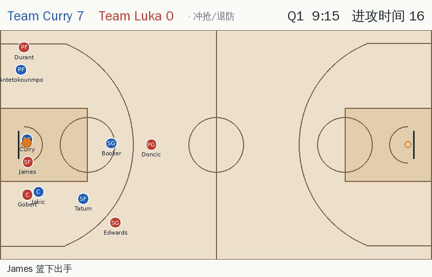
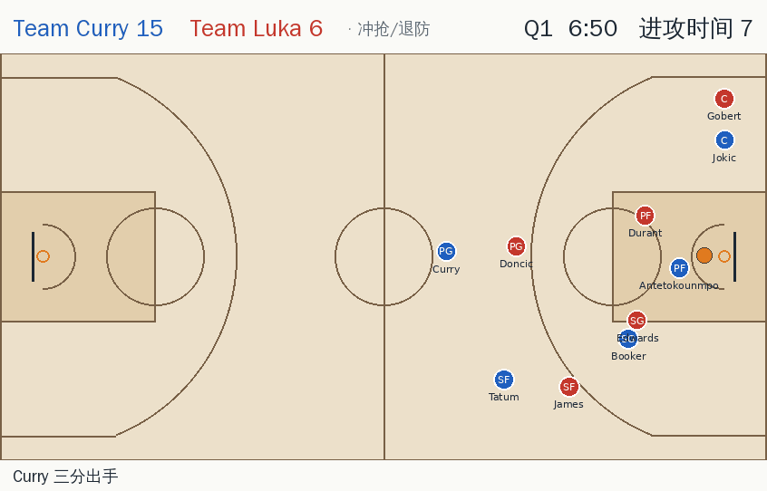

# nba-tactics-sim

多智能体 NBA 战术模拟器，同时也是强化学习环境。十名球员各是一个 agent，数值来自 NBA 2K27（2kratings.com）。全场引擎负责规则和裁决，脚本球队 AI 会跑常见战术、打人盯人防守；RL 策略可以接管任意球员，目标是学出新的战术。

设计方案：https://claude.ai/artifact/Cyp5Ju3peKZyprNP4VwUm5





两段 GIF 都来自 `replays/sample.json`（Team Curry vs Team Luka 第一节），用 `python scripts/make_gif.py --start <秒> --end <秒>` 生成。

## 快速开始

```bash
pip install -e ".[dev]"
python scripts/simulate.py                    # Team Curry vs Team Luka 一节，输出 replays/sample.json 和技术统计
python scripts/simulate.py --quarters 4       # 整场比赛
python scripts/calibrate.py --games 16        # 联盟平均阵容对比 2024-25 NBA 数据
python scripts/calibrate.py --games 8 --stars # 全明星阵容
pytest
```

看回放：在仓库根目录运行 `python -m http.server`，打开 http://localhost:8000/viewer/ 。也可以在页面里选择本地的回放 JSON。

## 规则（全场）

- 跳球开场，第 3 节交换方向，球权箭头；4 节 × 12 分钟，平局打 5 分钟加时。
- 24 秒进攻时间，进攻篮板重置为 14 秒；节末不足 24 秒时关闭。
- 8 秒过半场、回场违例、5 秒发球、进攻 3 秒、防守 3 秒（技术犯规罚球）。
- 投篮犯规（2/3 罚）、加罚、非投篮犯规、全队犯规 5 次进入罚球线（最后 2 分钟第 2 次即罚）。
- 盖帽、传球抢断、掏球、进攻犯规（撞人）、走步、传球出界。
- 投进后底线发球，死球边线发球，罚球站位。

## 数据与校准

- `data/players/nba2k27.yaml`：11 名真实球员的完整 2K27 属性（2kratings.com，2026-10-24 抓取）。
- `data/players/calibration.yaml`：5 名约 70 分的"联盟平均"合成球员，只用于校准。
- `data/league/nba_2024_25.yaml`：2024-25 赛季联盟平均（Basketball-Reference 场均、Cleaning the Glass 出手区域），以及 NBA.com 追踪数据的近似目标（传球、突破）。
- `scripts/tune.py` 用坐标下降搜索 `nbasim/resolve.py` 的结算常数和 `nbasim/agents/team.py` 的决策倾向，让平均阵容对打时的数据贴近 NBA，结果写入 `data/league/tuned_params.yaml`，导入时自动加载。

当前校准结果（`python scripts/calibrate.py --games 16`，平均阵容对打 16 场整场）：

| 指标 | 模拟 | NBA 2024-25 |
| --- | --- | --- |
| 每回合得分 | 1.149 | 1.120 |
| 节奏（每 48 分钟回合） | 97.0 | 99.6 |
| 投篮命中率 | .474 | .467 |
| 三分出手占比 / 命中率 | .427 / .372 | .422 / .360 |
| 罚球率（FTA/FGA） / 罚球命中率 | .222 / .783 | .243 / .780 |
| 失误率 | .141 | .140 |
| 进攻篮板率 | .251 | .252 |
| 抢断占失误比例 | .597 | .570 |
| 盖帽 / 出手 | .048 | .055 |
| 助攻 / 命中 | .595 | .635 |
| 出手分布：篮下 / 短中距 / 长两分 / 底角三分 / 弧顶三分 | .275 / .211 / .087 / .104 / .323 | .312 / .225 / .075 / .102 / .286 |
| 各区域命中率 | .688 / .408 / .452 / .368 / .374 | .663 / .442 / .417 / .389 / .356 |

两支全明星阵容对打时（8 场）：每回合 1.31 分、节奏 87、罚球率 .26，比联盟平均更高效，符合预期。

还没对齐的：突破次数偏多（约 84 次/队/场，NBA 约 50），传球略少（2.5 次/回合，NBA 约 2.8），全明星对局节奏偏慢。

## 真实比赛数据

目标是让模拟器能回答真实球队的问题（阵容和对位推演），并在留出的真实赛季上回测。方案见 https://claude.ai/artifact/FsEAbrqY8r1NyrLLacFW49 。

数据来自 NBA.com 的公开接口，存放在仓库的 `nba-data` 分支（2022-23 至 2026-27，每季约 50 MB）：

```bash
python scripts/fetch_nba.py                       # 在家用电脑上抓取（stats.nba.com 常屏蔽云服务器 IP）
git fetch origin nba-data && git worktree add ../nba-data origin/nba-data
ln -s ../../nba-data/data/nba data/nba            # 或直接复制
pip install -e ".[data]"
python scripts/build_dataset.py                   # 生成 data/processed/<赛季>/possessions.parquet、shots.parquet
```

`nbasim/data/pbp.py` 把逐场 play-by-play 切成回合，并通过换人记录追踪场上十人（每节首发由换人前的出场记录推断）。第 1 步验收结果：

| 赛季 | 场次 | 得分与官方一致 | 每队回合数 vs stats.nba.com（平均 / 最大误差） | 阵容不完整的回合 |
| --- | --- | --- | --- | --- |
| 2022-23 | 1230 | 100% | +0.07% / 0.23% | 0 |
| 2023-24 | 1230 | 100% | +0.08% / 0.21% | 0 |
| 2024-25 | 1230 | 100% | +0.08% / 0.35% | 16（0.006%） |
| 2025-26 | 1230 | 100% | +0.09% / 0.24% | 0 |
| 2026-27（截至 10 月 26 日） | 43 | 100% | +0.49% / 1.69% | 0 |

阵容层面，回合数最多的 200 套五人组里，按我们切出的回合算出的净效率和 NBA.com 的 NET_RATING 相关系数为 0.98（2024-25、2025-26）。

## 结构

| 路径 | 内容 |
| --- | --- |
| `nbasim/court.py` | 全场 94×50 英尺坐标，各队进攻方向的局部坐标，三分线、出手区域、战术点位 |
| `nbasim/players.py` | 2K27 属性分组的 Pydantic 模型，加载球员与阵容 |
| `nbasim/resolve.py` | 命中、盖帽、犯规、抢断、篮板等概率模型（以 2K 数值相对 70 分的 logistic 形式） |
| `nbasim/engine.py` | 10 Hz 确定性全场引擎：移动与碰撞、计时、规则、死球与罚球 |
| `nbasim/agents/team.py` | 脚本球队 AI：推进、快攻、战术执行、空间站位、持球人决策；人盯人、挡拆防守（沉退/换防）、协防、卡位 |
| `nbasim/playbook.py`, `data/plays/` | 战术库（高位挡拆、牛角、弹簧、西班牙挡拆、低位单打、拉开单打） |
| `nbasim/game.py` | 打整场比赛、技术统计、联盟口径的汇总指标 |
| `nbasim/macro.py` | RL 宏动作（AUTO、站位、传球、投篮、突破、掩护、盯人）、动作掩码、底层控制器 |
| `nbasim/env.py` | PettingZoo `ParallelEnv`，一个 episode 是一场（或若干节）比赛 |
| `nbasim/replay.py` | 回放日志格式（每 0.1 秒一帧，含事件和技术统计） |
| `viewer/index.html` | 全场 Canvas 回放器：比分牌、计时、战术标签、中文事件流、技术统计 |

## RL 环境

```python
from nbasim.env import NBAEnv
from nbasim.players import load_lineups

L = load_lineups()
env = NBAEnv(L["stars_a"], L["stars_b"], quarters=1, scripted=(1,))  # 只训练 A 队，B 队由脚本 AI 控制
obs, infos = env.reset(seed=0)
# obs[agent] = {"observation": float32[...], "action_mask": int8[...]}
```

- 智能体：`a_0..4` 和 `b_0..4`，顺序为 PG、SG、SF、PF、C。`scripted` 里的队伍不暴露为 agent。
- 动作 0 是 AUTO：这名球员交给脚本 AI。所以可以先只接管一个人，再逐步扩大，也方便做课程学习。
- 死球（发球、罚球、跳球）总是由脚本 AI 处理，此时只有 AUTO 合法。
- 一步 = 0.5 秒（引擎跑 5 个 tick）。观测以本队进攻方向为准，换边后不需要重新学习。
- 奖励：每一步本队得分减去对方得分，队内共享，零和。

## 已知问题

- 没有替补、体能和犯满离场（每队只有 5 人）。
- 追踪数据目标（传球、突破次数）是 NBA.com 联盟平均的近似值，定义也和官方不完全一致。
- 速度：单场 4 节约 20 秒（单核）。
